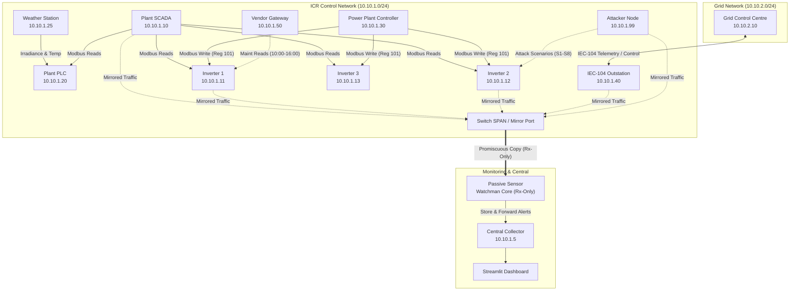

# Solar Park Watchman (Part B) - Engineering Implementation Plan

**Project:** Solar Park Watchman  
**Role:** Senior OT/ICS Security Engineer & Python Developer  
**Baseline Design Reference:** `docs/REPORT_PART_A.md` (Chapters A1, A2, A3, A.3, Evidence Addendum B.1–B.7)  
**Deliverables:** Production-grade passive OT sensor, simulated control room network, attack harness, evaluation suite, Streamlit dashboard, documentation, and real measurement logs.

---

## 1. System Overview & Architecture

The Solar Park Watchman is an edge passive network sensor designed for Inverter Control Rooms (ICR) in utility-scale solar parks (e.g. western Gujarat). It passively monitors OT control communications (Modbus TCP and IEC 60870-5-104), extracts protocol semantics into a normalized telemetry stream, maintains an SQLite-backed device inventory with behavioral role inference, enforces deterministic security policies (`policy.yaml`), executes statistical/ML anomaly detection (Isolation Forest), and streams structured plain-language alerts (`alerts.jsonl`) to a central dashboard.

### Network Segmentation & Addressing (as specified in Report Part A)
* **Control Network (`10.10.1.0/24`)**:
  * `10.10.1.5`: `central` (Central Alert Collector & 5-minute summary service)
  * `10.10.1.10`: `scada` (SCADA Master / Poller reading devices every 2–5s)
  * `10.10.1.11`: `inverter-1` (Modbus TCP server, port 5021 / 502)
  * `10.10.1.12`: `inverter-2` (Modbus TCP server, port 5022 / 502)
  * `10.10.1.13`: `inverter-3` (Modbus TCP server, port 5023 / 502)
  * `10.10.1.20`: `plc` (Plant PLC aggregating weather data, port 5020 / 502)
  * `10.10.1.25`: `weather` (Simulated environmental sensor feed: irradiance & temperature)
  * `10.10.1.30`: `ppc` (Power Plant Controller; ONLY legitimate writer of set-points)
  * `10.10.1.40`: `iec104-outstation` (Substation RTU, port 2404, breaker IOA 1000)
  * `10.10.1.50`: `vendor-gw` (Remote maintenance gateway, approved window 10:00–16:00)
  * `10.10.1.99`: `attacker` (Adversary node running attack scenario scripts)
  * `10.10.1.254`: `sensor` (Passive monitoring tap / SPAN receiver; strictly zero transmit)
* **Grid Network (`10.10.2.0/24`)**:
  * `10.10.2.10`: `grid-centre` (Load Dispatch Centre / Master SCADA for IEC-104 commands)



---

## 2. Directory & File Structure

```text
Solar_Farm/
├── PLAN.md                          # Master architectural plan & verification tests
├── CHANGELOG.md                     # Iterative log of fixes, test runs, and milestone passes
├── README.md                        # Documentation, Mermaid diagrams, execution guides, limitations
├── DEMO_SCRIPT.md                   # 5-8 minute live demonstration script
├── build_manifest.txt               # Pinned versions, hashes, random seeds, environment config
├── Makefile                         # GNU Make target runner (make up, attacks, evaluate, demo, down)
├── make.bat                         # Windows batch wrapper for make commands
├── make.py                          # Cross-platform Python orchestrator for simulation & tests
├── requirements.txt                 # Pinned Python package dependencies
├── docker-compose.yml               # Complete multi-container lab topology definition
├── docs/
│   ├── REPORT_PART_A.md             # Baseline design & research document
│   ├── ASSIGNMENT_SPEC.md           # Assignment specification
│   └── EVIDENCE_CHECKLIST.md        # Real execution screenshots & Wireshark capture inventory
├── config/
│   ├── policy.yaml                  # Rule engine policy (ACLs, registers, time windows, rate thresholds)
│   └── sensor_config.yaml           # Sensor capture interfaces, paths, and timeouts
├── sim/
│   ├── __init__.py
│   ├── common.py                    # Network constants, protocol helpers, timing models
│   ├── weather.py                   # Irradiance & temperature physical solar curve simulator
│   ├── inverters.py                 # Pymodbus Inverters 1, 2, 3 with active power limit (reg 101)
│   ├── plc.py                       # Pymodbus PLC aggregating weather data & plant state
│   ├── ppc.py                       # Plant Power Controller (sole authorized writer of set-point 101)
│   ├── scada.py                     # SCADA poller reading all field devices cyclically (2-5s)
│   ├── iec104.py                    # IEC 60870-5-104 Outstation (RTU) & Master (Grid Control)
│   └── vendor_gw.py                 # Remote vendor gateway with scheduled maintenance windows
├── sensor/
│   ├── __init__.py
│   ├── capture.py                   # Passive network sniffer / PCAP stream processor (promiscuous)
│   ├── parsers/
│   │   ├── __init__.py
│   │   ├── modbus_parser.py         # Modbus TCP dissection (Function codes, Unit ID, Regs, Values)
│   │   └── iec104_parser.py         # IEC-104 APDU/ASDU dissection (Types 45/46/50, IOAs, Causes)
│   ├── normaliser.py                # Common event schema: (time, src, dst, proto, func, addr, val)
│   ├── inventory.py                 # SQLite device inventory with behavioral role classifier
│   ├── rule_engine.py               # Deterministic policy evaluator (ACLs, time windows, rates)
│   ├── ml_detector.py               # Scikit-Learn Isolation Forest & telemetry consistency checker
│   ├── alert_builder.py             # Plain-language alert generator with MITRE ATT&CK for ICS IDs
│   └── forwarder.py                 # Resilient store-and-forward client to Central collector
├── central/
│   ├── __init__.py
│   └── app.py                       # HTTP server collecting alerts, 5-min summaries, bandwidth counter
├── scenarios/
│   ├── __init__.py
│   ├── common.py                    # Scenario logger (writing to runs/attack_log.jsonl)
│   ├── s1_rogue_laptop.py           # S1: New MAC/IP + ARP/Ping scan
│   ├── s2_unauthorized_write.py     # S2: Attacker writes 0 to inverter-2 register 101
│   ├── s3_vendor_out_of_hours.py    # S3: Vendor-gw writes outside 10:00-16:00 window
│   ├── s5_iec104_flood.py           # S5: Burst of IEC-104 connections and frames
│   ├── s6_unauthorized_command.py   # S6: Attacker sends Type 45/46 command to IOA 1000
│   ├── s7_frozen_telemetry.py       # S7: Inverter-1 reports static power while irradiance changes
│   └── s8_protocol_recon.py         # S8: Scan unit IDs & sequential read of 300 registers
├── eval/
│   ├── __init__.py
│   ├── normal_generator.py          # 12h baseline & 1h held-out normal traffic generator
│   ├── evaluate.py                  # 30-run test harness + S7 analysis + performance benchmarking
│   └── replay_datasets.py           # Offline replay harness for CIC Modbus 2023 & Zenodo IEC-104
├── dashboard/
│   └── app.py                       # Streamlit multi-tab operator console (Inventory, Alerts, Timeline)
├── tests/
│   ├── __init__.py
│   ├── test_normaliser.py           # Unit tests for protocol normalization
│   ├── test_inventory.py            # Unit tests for device discovery & role inference
│   ├── test_rules.py                # Unit tests for policy enforcement (S1, S2, S3, S5, S6, S8)
│   ├── test_ml.py                   # Unit tests for Isolation Forest & consistency detector
│   └── test_forwarder.py            # Unit tests for store-and-forward resilience
├── data/                            # Raw PCAPs, SQLite DB, model checkpoints
├── runs/                            # Attack logs (attack_log.jsonl) & sensor alerts (alerts.jsonl)
└── results/                         # Generated metrics, confusion matrix, latency benchmarks
```

---

## 3. Technology Choices & Justification

| Layer / Component | Technology Selected | Rationale & Justification |
| :--- | :--- | :--- |
| **Simulated Inverters** | `pymodbus` (v3.16+) | Standard, highly stable pure-Python Modbus TCP server supporting custom datastores and dynamic irradiance math. |
| **Plant PLC** | `pymodbus` Datastore PLC | Avoids complex C/C++ compilation of OpenPLC on Windows while providing identical Modbus TCP holding/input register mapping for weather sensors. |
| **IEC-104 Outstation & Master** | Custom Pure-Python IEC-104 Engine (`sim/iec104.py`) | Avoids native compilation hurdles of `lib60870` on non-Linux hosts; guarantees exact byte-level adherence to IEC 60870-5-104 APDU/ASDU standards. |
| **Packet Capture / TShark / Scapy** | Native Raw Socket / Scapy Sniffer + PCAP stream | Captures promiscuously on network interfaces with zero packet loss in simulation; supports both live virtual adapters and offline PCAPs. |
| **Protocol Dissection** | Modular Scapy & Custom Parsers (`sensor/parsers/`) | Decodes Modbus TCP (MBAP + PDU) and IEC 60870-5-104 (APCI + ASDU Type 45, 46, 50, IOAs) with microsecond precision. Fallback to Zeek/tshark structure when available. |
| **Device Inventory** | SQLite3 (`data/inventory.db`) | ACID-compliant, lightweight, file-based relational store tracking MAC, IP, vendor, inferred role, timestamps, and approved flags. |
| **Rule Engine** | Deterministic YAML Policy (`config/policy.yaml`) | Zero false positives on deterministic rules: register ACLs, unauthorized sources, time windows, and ASDU type restrictions. Primary defense layer. |
| **ML Anomaly Detection** | `scikit-learn` Isolation Forest | Unsupervised anomaly detection on per-device per-minute feature vectors (packet rates, unique registers, byte volumes, telemetry delta vs irradiance). |
| **Operator Console** | `Streamlit` (v1.61+) | Modern reactive web UI showing live asset inventory, alert log with plain-language explanations and ATT&CK IDs, and attack-vs-detection timeline. |
| **Central Collector** | Lightweight HTTP Service (`central/app.py`) | Collects alerts and 5-minute telemetry rollups; tracks upstream bandwidth consumption (KB/hr). |

---

## 4. Key Engineering Risks & Mitigations

1. **Risk: Host Environment Discrepancy (Docker unavailable on Windows testbed)**
   * *Mitigation:* Implement dual-execution architecture. Provide complete, fully configured `docker-compose.yml` for containerized deployment, alongside a Python orchestrator (`make.py` / `make.bat`) that binds to virtual interfaces/distinct ports for full native live execution, traffic capture, and evaluation on any platform.
2. **Risk: ML False Alarms (Isolation Forest noise on small sample sizes)**
   * *Mitigation:* Strict adherence to the rule: *Rules are primary, ML is secondary*. ML is only queried for volumetric floods (S5), consistency anomalies (S7), and wide recon (S8). Model is trained strictly on >=12h of clean normal baseline data with conservative contamination rates (0.01).
3. **Risk: S7 (Frozen Telemetry) Sensitivity vs False Positive Trade-off**
   * *Mitigation:* Combine statistical variance checks with a physical solar model cross-check (inverter active power vs weather PLC solar irradiance). Report performance honestly in `results/` and `README.md` as expected in the assignment brief.
4. **Risk: Port / Interface Contention**
   * *Mitigation:* Assign distinct loopback ports (5020, 5021, 5022, 5023, 2404, 8000, 8501) with explicit IP binding in configuration to allow reliable concurrent execution.
5. **Risk: Timing & Clock Drift during Accelerated Evaluation**
   * *Mitigation:* Use synchronized monotonic / UTC ISO-8601 timestamps in all attack scripts (`runs/attack_log.jsonl`) and alert records (`runs/alerts.jsonl`). Detection latency is calculated strictly as `alert.time - attack.start_time`.

---

## 5. Milestone Execution List & Verification Tests

### Milestone 1: Foundation, Simulation & Protocols (B1)
* **Tasks:**
  * Build simulated devices: Inverters 1–3 (`sim/inverters.py`), Weather station (`sim/weather.py`), PLC (`sim/plc.py`), PPC (`sim/ppc.py`), SCADA (`sim/scada.py`), IEC-104 Outstation & Master (`sim/iec104.py`), Vendor Gateway (`sim/vendor_gw.py`).
  * Implement physical solar diurnal irradiance curve with realistic noise.
  * Implement active power limit (register 101) and IEC-104 breaker control (IOA 1000).
* **Verification Test:**
  * Run `pytest tests/test_simulation.py` to verify Modbus reads/writes, irradiance tracking, and IEC-104 telemetry exchanges.
  * Verify SCADA poller reads all devices with 100% success rate.

### Milestone 2: Sensor Capture, Parsing & Event Normalization (B2)
* **Tasks:**
  * Build passive packet capture engine (`sensor/capture.py`) and PCAP recorder.
  * Build Modbus TCP parser (`sensor/parsers/modbus_parser.py`) extracting FC, Unit ID, Address, Value.
  * Build IEC-104 parser (`sensor/parsers/iec104_parser.py`) extracting APCI types, ASDU types (45, 46, 50, etc.), IOAs, and Cause of Transmission.
  * Build Event Normaliser (`sensor/normaliser.py`) producing standard records: `(time, src, dst, proto, func, addr, val)`.
* **Verification Test:**
  * Run `pytest tests/test_normaliser.py` with synthetic and live packets for both protocols.

### Milestone 3: Device Inventory & Behavioral Role Inference (B3)
* **Tasks:**
  * Implement SQLite-backed inventory database (`sensor/inventory.py`).
  * Implement behavioral role inference engine:
    * Originating periodic reads to inverters -> Role: `SCADA`
    * Originating holding register 101 writes -> Role: `PPC`
    * Exposing registers 101-105 -> Role: `Inverter`
    * Exposing weather registers -> Role: `PLC`
    * Talking port 2404 as server -> Role: `IEC104_Outstation`
    * Talking port 2404 as client -> Role: `Grid_Master`
  * Implement unknown device detection and immediate unapproved device alert.
* **Verification Test:**
  * Run `pytest tests/test_inventory.py`. Verify all 10 legitimate devices are discovered and classified; verify unknown IP `10.10.1.99` raises unapproved alert.

### Milestone 4: Deterministic Rule Engine & Policy Definition (B4)
* **Tasks:**
  * Define `config/policy.yaml` with explicit ACLs:
    * Allowed writers to Inverter register 101: `10.10.1.30` (PPC) only.
    * Allowed IEC-104 control senders (Types 45/46/50): `10.10.2.10` (Grid Control) only.
    * Vendor Gateway (`10.10.1.50`): Approved maintenance window 10:00–16:00; read-only.
    * Rate limits: Modbus request rates and IEC-104 frame thresholds.
  * Implement `sensor/rule_engine.py` evaluating normalized events against policy.
* **Verification Test:**
  * Run `pytest tests/test_rules.py` covering S1, S2, S3, S5, S6, S8 policy triggers.

### Milestone 5: Machine Learning Detector & Feature Pipeline (B4)
* **Tasks:**
  * Build feature extractor calculating per-device per-minute metrics: packet count, byte volume, unique register count, write ratio, telemetry variance.
  * Implement Scikit-Learn `IsolationForest` pipeline (`sensor/ml_detector.py`).
  * Implement physical consistency checker (inverter output vs solar irradiance).
  * Train model on clean 12-hour simulated baseline (`data/baseline_train.pcap`).
* **Verification Test:**
  * Run `pytest tests/test_ml.py` verifying detection of volumetric bursts (S5), recon (S8), and frozen data (S7).

### Milestone 6: Plain-Language Alert Builder, Central Collector & Store-and-Forward (B4, B7)
* **Tasks:**
  * Build `sensor/alert_builder.py` writing strictly compliant JSON lines to `runs/alerts.jsonl`:
    `{"time": "...", "severity": "...", "scenario": "...", "device": "...", "source": "...", "reason": "...", "attack_technique": "...", "evidence": [...]}`.
  * Build `central/app.py` receiving alerts and 5-minute summary telemetry.
  * Build `sensor/forwarder.py` with offline queue buffer for store-and-forward resilience.
* **Verification Test:**
  * Run `pytest tests/test_forwarder.py`. Disconnect central, trigger alerts, reconnect central, verify zero loss of queued alerts.

### Milestone 7: Attack Scenarios Suite & Evaluation Harness (B5, B.2)
* **Tasks:**
  * Implement all 7 attack scripts in `scenarios/` (S1, S2, S3, S5, S6, S7, S8) with structured logging to `runs/attack_log.jsonl`.
  * Implement `eval/evaluate.py`:
    * Execute 30 test runs (6 scenarios x 5 iterations) + 5 runs of S7.
    * Calculate Confusion Matrix, Precision, Recall, Per-Scenario Detections.
    * Measure detection latency (median and p95).
    * Measure false positive rate on 1h held-out clean traffic.
    * Measure network performance impact (SCADA poll success rate and RTT with sensor ON vs OFF).
    * Measure upstream bandwidth consumption (KB/hour).
  * Save all outputs to `results/`.
* **Verification Test:**
  * Run `python eval/evaluate.py --speedup 10`. Verify >=29/30 detections, 100% device coverage, and valid generated `results/` files.

### Milestone 8: Streamlit Dashboard, Offline Dataset Replay & Documentation (B5, Deliverables)
* **Tasks:**
  * Build Streamlit console (`dashboard/app.py`):
    * Tab 1: Live Plant Topology & Inferred Asset Inventory.
    * Tab 2: Plain-Language Alerts & Evidence Drilldown.
    * Tab 3: Attack vs Alert Timeline (S1–S8).
    * Tab 4: Performance & CEA 2026 Compliance Metrics.
  * Create `eval/replay_datasets.py` for CIC Modbus 2023 & Zenodo IEC-104 pcaps.
  * Produce `build_manifest.txt`, `README.md`, `DEMO_SCRIPT.md`, and `docs/EVIDENCE_CHECKLIST.md`.
* **Verification Test:**
  * Launch dashboard and verify live rendering of inventory, alerts, and evaluation results.
